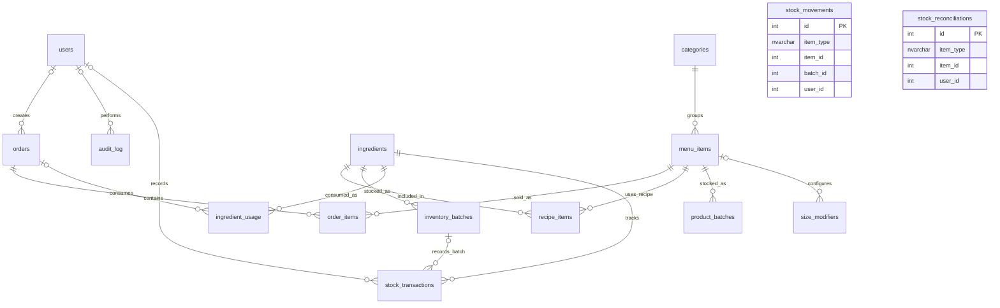

# Cafe POS database and defense guide

This guide maps the Cafe POS implementation to the database project rubric. The relationship and constraint examples were checked against the local `CafePOS` SQL Server database.

| Criterion | Weight | Evidence in this guide |
|---|---:|---|
| Constraints | 15% | Verified primary key, foreign key, unique, default, and check examples |
| Table relationships and structure | 20% | ERD and full column dictionary |
| System functionality | 15% | Demo sequence and test record |
| Use of stored procedures and views | 20% | CRUD examples and view dependencies |
| Explanation of stored procedures | 20% | Inputs, outputs, and transaction behavior |
| Documentation | 10% | Reusable material for LMR and DDR |

## Entity relationship diagram

The diagram shows declared foreign keys. Each parent can have zero or more related rows. An optional parent indicates a nullable foreign key.

`recipe_items` resolves the many-to-many relationship between menu items and ingredients. `stock_movements` and `stock_reconciliations` use `item_type` and `item_id` to associate a row with either an ingredient or a product. Those associations are handled by the app and SQL queries. The live schema does not declare foreign keys for those two tables.

## Verified constraints

| Type | Database example | What it enforces |
|---|---|---|
| Primary key | `orders.id` | Each order has a unique, non-null identifier. |
| Foreign key | `FK_order_items_orders` on `order_items.order_id` | An order line references an existing order. |
| Unique | `users.username` | The same username cannot be registered twice under the database collation. Categories and ingredient names also have unique constraints. |
| Default | `DF_orders_status` on `orders.status` | SQL Server supplies `Pending` when an insert omits the status. |
| Check | `CK_orders_status` | An order status must be `Pending`, `Completed`, or `Cancelled`. |
| Check | `CK_product_batches_quantity` | A product batch cannot have a negative quantity. |

## Stored procedures and views

PHP uses parameterized `EXEC` calls for CRUD. SQL Server procedures contain the statements that read or change rows. PHP checks permissions and coordinates transactions that span several operations.

| Operation | Procedure | Input and result |
|---|---|---|
| Create | `CreateIngredient` | Takes name, unit, low-stock threshold, and cost. Returns the new ingredient ID. |
| Read | `GetSalesReportTotals` | Takes inclusive start and end timestamps. Returns overall, daily, and payment-method totals for completed orders. |
| Update | `SetPendingOrderStatus` | Takes the new status and order ID. Updates a matching pending order. PHP checks that one row was affected. |
| Delete | `DeleteIngredient` | Takes an ingredient ID. The PHP workflow checks zero stock and references inside its transaction before calling the procedure. |

- `vw_CompletedOrders` centralizes the completed-order filter. Both `GetSalesReportTotals` and `GetBestSellingMenuItems` reuse it.
- `vw_InventoryBatches` combines ingredient and product batches and exposes their remaining value. Inventory and Dashboard procedures reuse it.

For the defense, open `controllers/sales_reports.php` and point out the bound date parameters in the `EXEC` call. Then open `database/sales_reporting.sql` and trace the procedure to the view and underlying orders table. Explain that checkout and cancellation execute multiple procedures in a single PHP-managed transaction, allowing a failed workflow to roll back its changes.

## Demo and test record

Run the demo against `CafePOS_Test`. Use the group ZIP’s README for setup and test accounts.

| Step | Expected result | Evidence or test status |
|---|---|---|
| Install from a fresh ZIP extraction | Sample schema, accounts, and all migrations install | Verified on an isolated database with 115 procedures |
| Sign in and open the main screens | Dashboard, New Order, Inventory, Sales Reports, and Menu Management load | Verified from the extracted package |
| Place a cash order and open the receipt | A pending order appears, the receipt shows cash and change, and stock is deducted | Full workflow pending. Record order ID and stock before and after. |
| Cancel the pending order | The order changes to Cancelled and stock returns to its starting level | Full workflow pending. Record batch and item balances before and after. |
| Explain procedure verification | Returned IDs, affected-row checks, stock restoration, and rollback behave as expected | Verified with a procedure-level transaction in `CafePOS_Test` |
| Open Sales Reports and export CSV | Report and CSV reflect the selected range and completed orders | Populated and empty date ranges verified during migration |

## LMR and DDR

The rubric names LMR and DDR without defining their required sections. Use the professor’s template to place the ERD, data dictionary, procedure and view examples, and test evidence in the correct deliverables.

## Data dictionary

Types, nullability, and defaults below reflect the live `CafePOS` schema. A dash indicates no declared default.

### `audit_log`

| Column | SQL type | Nullable | Default |
|---|---|---|---|
| `id` (identity) | `int` | No | - |
| `user_id` | `int` | Yes | - |
| `username` | `nvarchar(100)` | Yes | - |
| `action` | `nvarchar(100)` | No | - |
| `details` | `nvarchar(max)` | Yes | - |
| `created_at` | `datetime2(7)` | Yes | `(sysdatetime())` |

### `categories`

| Column | SQL type | Nullable | Default |
|---|---|---|---|
| `id` (identity) | `int` | No | - |
| `name` | `nvarchar(150)` | No | - |

### `ingredient_usage`

| Column | SQL type | Nullable | Default |
|---|---|---|---|
| `id` (identity) | `int` | No | - |
| `ingredient_id` | `int` | No | - |
| `quantity_used` | `float` | No | - |
| `order_id` | `int` | Yes | - |
| `created_at` | `datetime2(7)` | Yes | `(sysdatetime())` |

### `ingredients`

| Column | SQL type | Nullable | Default |
|---|---|---|---|
| `id` (identity) | `int` | No | - |
| `name` | `nvarchar(150)` | No | - |
| `unit` | `nvarchar(50)` | No | - |
| `stock_qty` | `float` | Yes | `((0))` |
| `low_stock_threshold` | `float` | Yes | `((10))` |
| `cost_per_unit` | `float` | Yes | `((0))` |
| `initial_quantity` | `float` | Yes | `((0))` |
| `expiration_date` | `nvarchar(50)` | Yes | `(N'')` |
| `is_archived` | `bit` | No | `((0))` |

### `inventory_batches`

| Column | SQL type | Nullable | Default |
|---|---|---|---|
| `id` (identity) | `int` | No | - |
| `ingredient_id` | `int` | No | - |
| `quantity` | `float` | Yes | `((0))` |
| `cost_per_unit` | `float` | Yes | `((0))` |
| `received_date` | `nvarchar(50)` | Yes | - |
| `expiration_date` | `nvarchar(50)` | Yes | - |
| `supplier` | `nvarchar(255)` | Yes | `(N'')` |
| `notes` | `nvarchar(max)` | Yes | `(N'')` |
| `created_at` | `datetime2(7)` | Yes | `(sysdatetime())` |

### `menu_items`

| Column | SQL type | Nullable | Default |
|---|---|---|---|
| `id` (identity) | `int` | No | - |
| `name` | `nvarchar(150)` | No | - |
| `price` | `float` | No | - |
| `category_id` | `int` | No | - |
| `image_path` | `nvarchar(500)` | Yes | - |
| `available` | `int` | Yes | `((1))` |
| `stock_qty` | `int` | Yes | `((50))` |
| `discount` | `int` | Yes | `((0))` |
| `has_temp_option` | `int` | Yes | `((0))` |
| `has_sizes` | `int` | Yes | `((0))` |
| `is_archived` | `int` | Yes | `((0))` |

### `order_items`

| Column | SQL type | Nullable | Default |
|---|---|---|---|
| `id` (identity) | `int` | No | - |
| `order_id` | `int` | No | - |
| `menu_item_id` | `int` | No | - |
| `quantity` | `int` | No | `((1))` |
| `size` | `nvarchar(50)` | Yes | `(N'Regular')` |
| `subtotal` | `float` | No | - |

### `orders`

| Column | SQL type | Nullable | Default |
|---|---|---|---|
| `id` (identity) | `int` | No | - |
| `order_type` | `nvarchar(30)` | No | - |
| `status` | `nvarchar(30)` | No | `(N'Pending')` |
| `total` | `float` | No | `((0))` |
| `created_by` | `int` | Yes | - |
| `created_at` | `datetime2(7)` | Yes | `(sysdatetime())` |
| `payment_method` | `nvarchar(100)` | Yes | `(N'')` |
| `amount_tendered` | `float` | Yes | `((0))` |
| `change_amount` | `float` | Yes | `((0))` |
| `tax` | `float` | Yes | `((0))` |
| `ref_number` | `nvarchar(100)` | Yes | `(N'')` |

### `product_batches`

| Column | SQL type | Nullable | Default |
|---|---|---|---|
| `id` (identity) | `int` | No | - |
| `menu_item_id` | `int` | No | - |
| `quantity` | `int` | No | - |
| `cost_per_unit` | `decimal(10,2)` | No | - |
| `received_date` | `date` | No | - |
| `expiration_date` | `date` | Yes | - |
| `supplier` | `nvarchar(150)` | Yes | - |
| `notes` | `nvarchar(500)` | Yes | - |
| `created_at` | `datetime2(7)` | No | `(sysdatetime())` |

### `recipe_items`

| Column | SQL type | Nullable | Default |
|---|---|---|---|
| `id` (identity) | `int` | No | - |
| `menu_item_id` | `int` | No | - |
| `ingredient_id` | `int` | No | - |
| `quantity_needed` | `float` | No | - |

### `size_modifiers`

| Column | SQL type | Nullable | Default |
|---|---|---|---|
| `id` (identity) | `int` | No | - |
| `name` | `nvarchar(100)` | No | - |
| `price_adjustment` | `float` | Yes | `((0))` |
| `menu_item_id` | `int` | Yes | - |

### `stock_movements`

| Column | SQL type | Nullable | Default |
|---|---|---|---|
| `id` (identity) | `int` | No | - |
| `item_type` | `nvarchar(20)` | No | - |
| `item_id` | `int` | No | - |
| `batch_id` | `int` | Yes | - |
| `movement_type` | `nvarchar(30)` | No | - |
| `quantity` | `decimal(12,3)` | No | - |
| `remarks` | `nvarchar(500)` | Yes | - |
| `user_id` | `int` | Yes | - |
| `created_at` | `datetime2(7)` | No | `(sysdatetime())` |

### `stock_reconciliations`

| Column | SQL type | Nullable | Default |
|---|---|---|---|
| `id` (identity) | `int` | No | - |
| `item_type` | `nvarchar(20)` | No | - |
| `item_id` | `int` | No | - |
| `previous_stock` | `decimal(18,3)` | No | - |
| `corrected_stock` | `decimal(18,3)` | No | - |
| `reason` | `nvarchar(500)` | No | - |
| `user_id` | `int` | No | - |
| `created_at` | `datetime2(7)` | Yes | `(sysdatetime())` |

### `stock_transactions`

| Column | SQL type | Nullable | Default |
|---|---|---|---|
| `id` (identity) | `int` | No | - |
| `ingredient_id` | `int` | No | - |
| `type` | `nvarchar(50)` | No | - |
| `quantity` | `float` | No | - |
| `reason` | `nvarchar(500)` | Yes | `(N'')` |
| `batch_id` | `int` | Yes | - |
| `user_id` | `int` | Yes | - |
| `created_at` | `datetime2(7)` | Yes | `(sysdatetime())` |

### `users`

| Column | SQL type | Nullable | Default |
|---|---|---|---|
| `id` (identity) | `int` | No | - |
| `username` | `nvarchar(100)` | No | - |
| `email` | `nvarchar(255)` | Yes | - |
| `password` | `nvarchar(255)` | No | - |
| `role` | `nvarchar(30)` | No | - |
| `created_at` | `datetime2(7)` | Yes | `(sysdatetime())` |
| `is_active` | `bit` | No | `((1))` |
| `session_version` | `bigint` | No | `((0))` |
